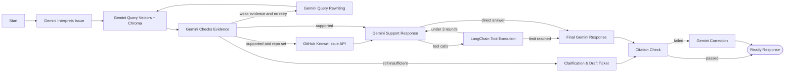

# SupportLens · Agentic RAG Customer Support Agent

[](https://www.python.org/)
[](https://streamlit.io/)
[](https://docs.langchain.com/oss/python/langgraph)
[](https://www.trychroma.com/)
[](https://ai.google.dev/)
[](LICENSE)

**SupportLens** is an intelligent customer support agent powered by **Agentic Retrieval-Augmented Generation (RAG)**. It indexes heterogeneous product documentation (PDF, DOCX, Markdown, TXT) into Chroma using dense Gemini embeddings, retrieves evidence-backed passages, evaluates whether the evidence justifies a solution, and synthesizes cited answers or drafts structured escalation tickets.

Every response is derived from actual Google Gemini calls and vector similarity scoring, with rigorous citation tracking.

---

## Key Features

- **Multi-Format Document Parsing**: Ingests PDF (with page awareness), DOCX (including tables), Markdown, and TXT with chunking and metadata preservation.
- **Dense Semantic Embeddings**: Uses `gemini-embedding-001` and an ephemeral Chroma vector store per session for cosine similarity retrieval.
- **Agentic RAG with Self-Correction**: Implements LangGraph state machine with automatic query reformulation, retry loops, and evidence sufficiency evaluation.
- **Strict Grounding & Escalation**: Prevents hallucinations—if documentation is insufficient, SupportLens escalates gracefully with clarification questions and exportable ticket drafts.
- **GitHub Known-Issues Tool**: Optionally connects to GitHub's REST API to cross-reference reported software bugs.

---

## Agent Workflow



### Integrated LangChain Tools

- `search_manuals`: Retrieves semantic passages from indexed manuals with citation identifiers `[D-xxxxxxxx]`.
- `lookup_known_issues`: Searches real GitHub issues in the user's selected product repository.
- `draft_support_ticket`: Synthesizes an exportable structured JSON ticket draft without making external state mutations.

---

## Quickstart

### Prerequisites

- Python 3.12 or newer
- Google Gemini API key ([Google AI Studio](https://aistudio.google.com/))
- *(Optional)* GitHub Personal Access Token (for known-issues search)

### 1. Clone & Set Up

```bash
git clone https://github.com/zorox06/supportlens.git
cd supportlens
```

### 2. Configure Credentials

Choose one of three ways to supply your API credentials:

- **Streamlit UI**: Enter your key directly in the sidebar on launch.
- **Environment Variables**:
  ```bash
  export GEMINI_API_KEY="your_api_key_here"
  export GITHUB_TOKEN="optional_github_token"
  ```
- **Local Config File**: Copy `local_config.example.py` to `local_config.py` (which is excluded from Git):
  ```bash
  cp local_config.example.py local_config.py
  ```

### 3. Run Locally

**Windows (One-click launcher):**
```cmd
start.bat
```

**Cross-Platform Manual Setup:**
```bash
python -m venv .venv
source .venv/bin/activate  # On Windows: .venv\Scripts\activate
pip install -r requirements.txt
streamlit run app.py --server.port 8503
```

Open your browser at `http://127.0.0.1:8503`.

---

## Docker Deployment

Build and run in an isolated container:

```bash
docker build -t supportlens .
docker run --rm -p 8503:8501 -e GEMINI_API_KEY="your_api_key_here" supportlens
```

---

## Running Tests

Automated test suites cover deterministic vector retrieval, document parsing (PDF, DOCX, Markdown), citation validator checks, query reformulation, and escalation ticket drafting:

```bash
pip install -r requirements-dev.txt
pytest
```

---

## Project Structure

```
supportlens/
├── .github/workflows/ci.yml # Automated CI pipeline
├── .streamlit/config.toml   # Custom dark theme configuration
├── data/                    # Sample DeskSync product manuals and policies
│   ├── DeskSync_manual.md
│   └── DeskSync_support_policy.md
├── docs/                    # Validation documentation
│   └── VALIDATION.md
├── examples/                # Verified live runs and evaluation traces
│   ├── escalation-live.json
│   ├── escalation-live.md
│   ├── github-api-check.json
│   ├── resolved-live.json
│   └── resolved-live.md
├── src/
│   ├── __init__.py
│   ├── agent.py             # LangGraph Agentic RAG workflow and state machine
│   ├── knowledge.py         # Multi-format parser, chunker, and Chroma integration
│   ├── tools.py             # Support tools, issue search, and ticket drafting
│   └── ui.py                # Streamlit UI styling and component helpers
├── tests/
│   └── test_supportlens.py  # Unit and integration test suite
├── .dockerignore
├── .env.example
├── .gitignore
├── app.py                   # Streamlit web application entry point
├── config.py                # Environment configuration loader
├── Dockerfile
├── LICENSE                  # MIT License
├── local_config.example.py  # Template for optional local credentials
├── pytest.ini
├── README.md
├── requirements.txt
├── requirements-dev.txt
└── start.bat                # Windows setup & launch script
```

---

## License

This project is licensed under the [MIT License](LICENSE).
